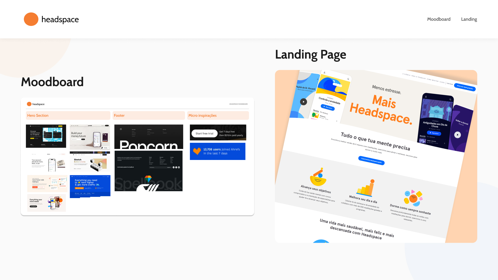
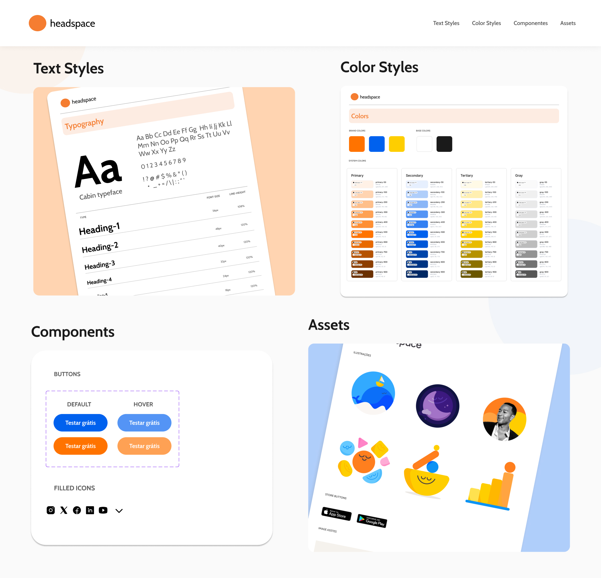
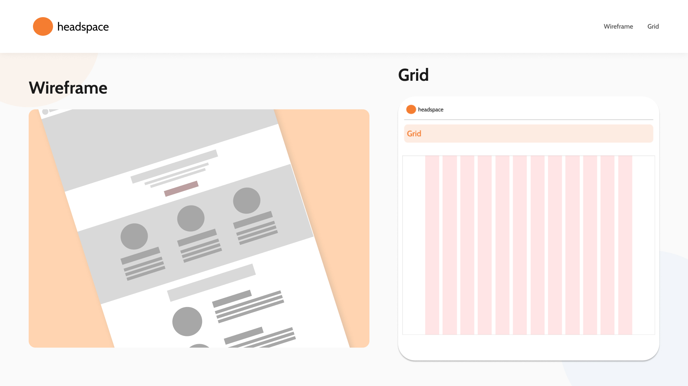
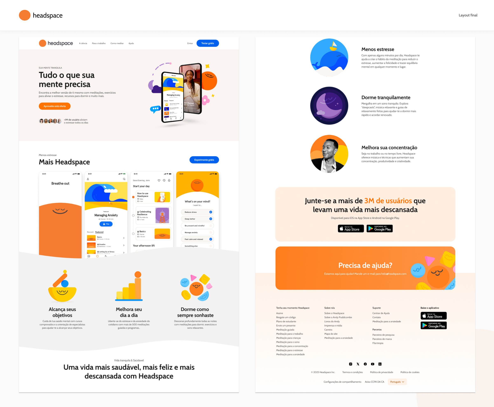

  

> Figma • UI Design • Design System • Prototipação

Projeto de estudo voltado à recriação e interpretação da landing page do **Headspace**, desenvolvido como exercício prático de UI Design, prototipação no Figma e construção de Design Systems.

O projeto teve como foco explorar a estrutura visual da interface original, compreender suas decisões de design e aplicar esses conceitos na construção de uma nova composição visual, priorizando consistência, organização e hierarquia.

---

# ★ Objetivo 

Praticar fundamentos de UI Design e prototipação por meio da recriação de uma landing page, explorando a organização de layouts, construção de componentes e estruturação de um Design System.

---

# ✎ Processo de desenvolvimento

O desenvolvimento começou com a análise da [landing page original](assets/images/reference.jpg), observando sua identidade visual, tipografia, cores e organização dos elementos.

  

A partir dessas referências, foi elaborado um moodboard para orientar a direção visual do projeto. Em seguida, desenvolvi um Design System, organizando estilos de cores, tipografia, componentes e assets.

  

Com essa estrutura definida, passei para a construção dos wireframes e desenvolvimento do [layout final](assets/images/final-project.jpg), explorando recursos do Figma para garantir consistência e organização entre os elementos.

  

  

---
# ✦ Principais atividades

- Análise da interface original e referências visuais.
- Construção de moodboard e definição da direção visual.
- Organização de Color Styles e Text Styles.
- Criação e organização de componentes reutilizáveis.
- Desenvolvimento de wireframes e layout final.
- Aplicação de Auto Layout e organização por grid.
- Estruturação de um Design System no Figma.

---

# ✦ Ferramentas

**Figma:** UI Design, prototipação e organização do Design System.

---

# 「」Resultado final

🔗 [Visualizar projeto no Figma](https://www.figma.com/proto/X3a1kxGwY3QHxaHCDEiGOF/Projeto-Headspace?node-id=38-18&viewport=255%2C468%2C0.26&t=iT4JEB0ZlUiKgdOF-1&scaling=min-zoom&content-scaling=fixed&starting-point-node-id=38%3A18&page-id=27%3A578)

---

# ★ Aprendizados

Durante o desenvolvimento, pude consolidar conhecimentos sobre:

- Criação de escalas tipográficas consistentes.
- Aplicação e importância do Auto Layout.
- Estruturação e organização de Design Systems.
- Reutilização de componentes.
- Organização de interfaces pensando no handoff.
- Importância das decisões visuais para a experiência do usuário.